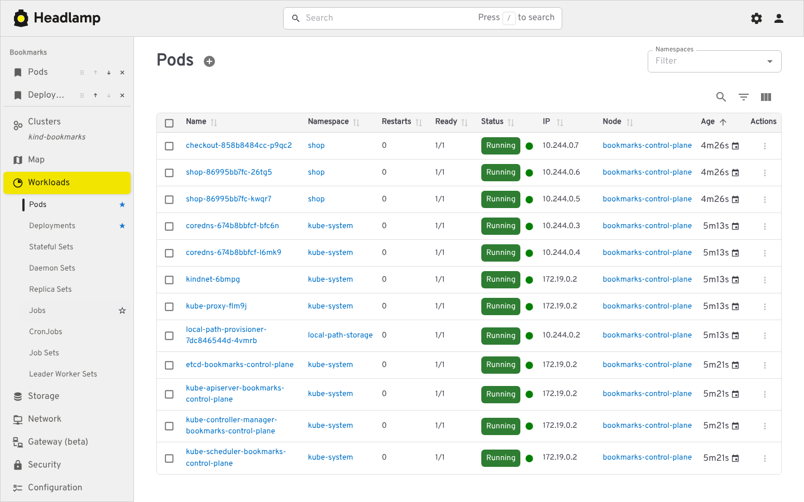
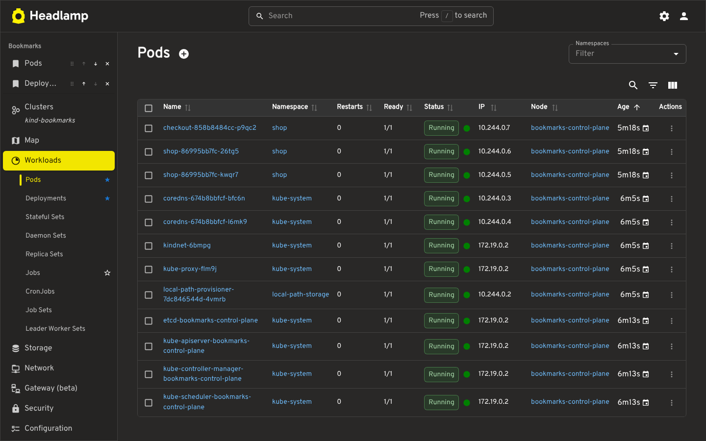
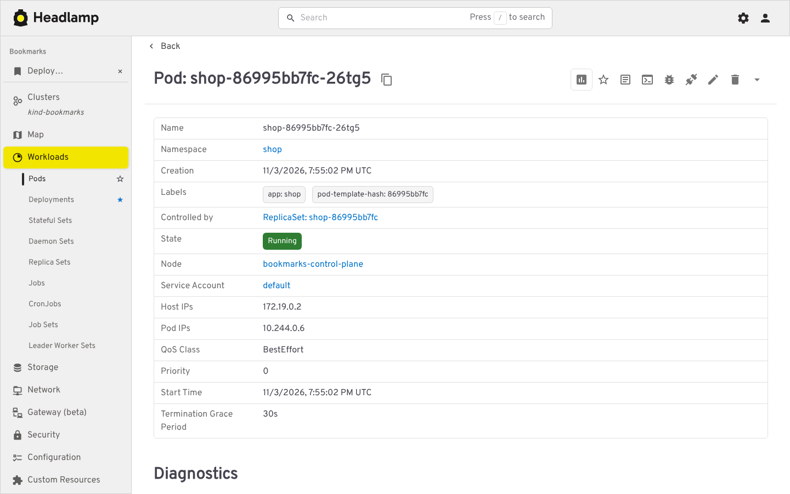
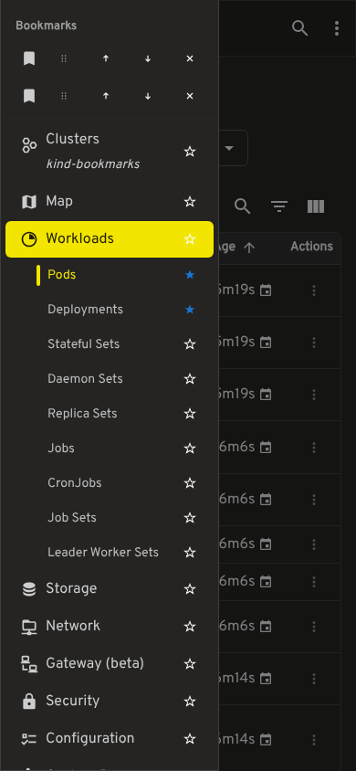

# Bookmarks

A Headlamp plugin that stars navigation rows and resource pages. Stars are stored in this browser under `buttah-bookmarks`. The open cluster's bookmarks pin to the top of the sidebar. Other clusters keep their own lists.

The controls follow Headlamp's theme.

## What it adds

- A star on each expanded navigation row. The star fills while that page is bookmarked.
- A star in the resource details header. A details drawer bookmarks the resource's own page, not the list behind it.
- A **Bookmarks** section at the top of the sidebar: reorder by drag or the up and down buttons, or remove a row. The section hides when the open cluster has no bookmarks.
- A jump route (`/buttah/go/...` inside a cluster, `/buttah/page/...` outside one) because Headlamp sidebar links cannot carry a query string. The route replaces itself with the saved URL.
- At most 40 bookmarks per cluster. Labels and icons are cleaned, and only same-cluster paths are stored.

Plugin settings explain that the list stays in the browser. There is no cluster write.

## Screenshots

These are Headlamp v0.46.0 on a kind cluster named `bookmarks`. Pods and Deployments are starred. The Jobs row is showing its outline star on hover. The table is the cluster's real pod list, including the `shop` workloads.



The same cluster with Headlamp's Dark theme.



The details header star on `shop` in the `shop` namespace. The sidebar star for that resource's own page is separate from the Pods list star.



On a phone-width window the drawer keeps the bookmark rows and the stars.



`npm run screenshots` recaptures these from a Headlamp that is already serving this plugin. It reads `HEADLAMP_URL` (default `http://127.0.0.1:4466`), `HEADLAMP_CLUSTER` (default `kind-bookmarks`), and `HEADLAMP_NAMESPACE` (default `shop`). Playwright is installed outside this package.

## Build

```sh
cd buttah-bookmarks
npm ci
npm run tsc
npm run lint
npm test
npm run build
npm run package
```

Requires Node.js 22 or 23 and npm 10. The build escapes control bytes in `dist/main.js` so the bundle can be stored in a Kubernetes manifest.

Install the packaged directory as `buttah-bookmarks` under Headlamp's plugins directory, or use the repository image `ghcr.io/buttahtoast/headlamp-plugins/buttah-bookmarks`. The image copies into `/plugins/buttah-bookmarks`.
